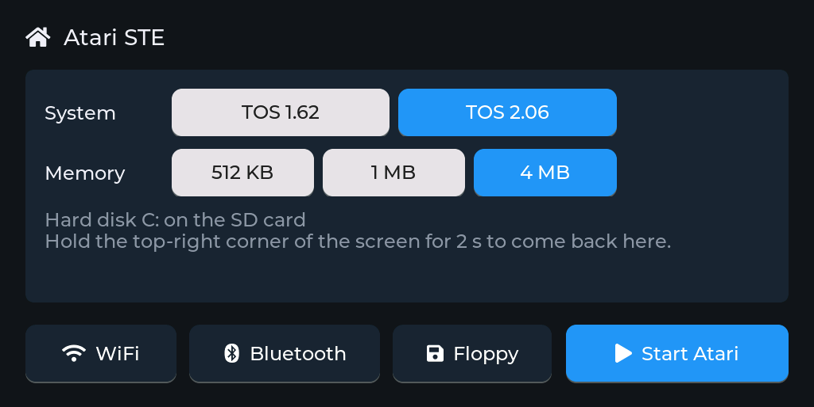
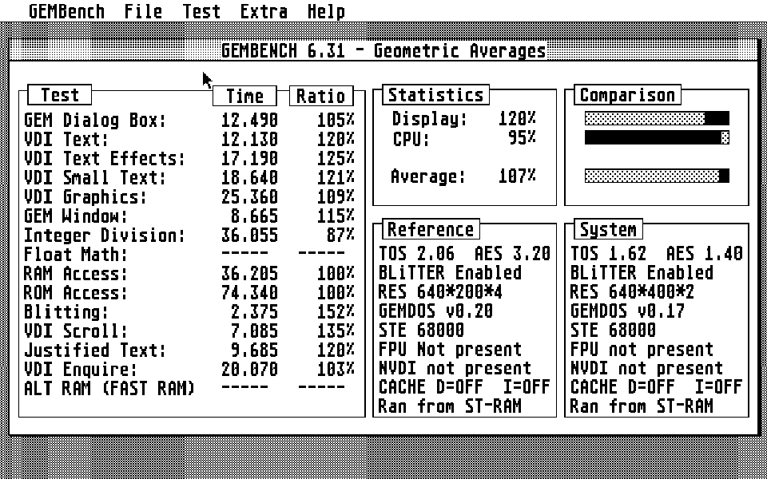
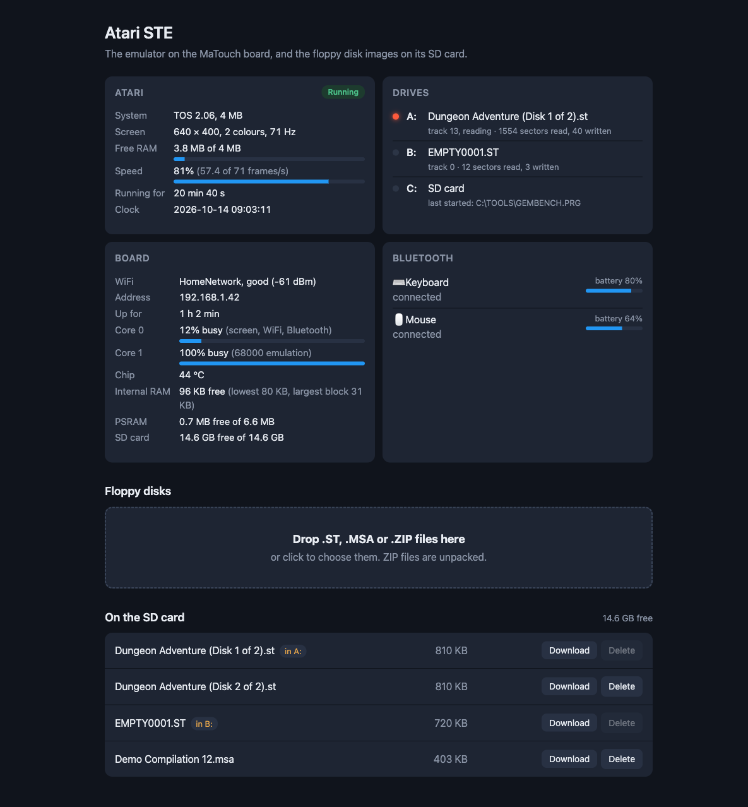
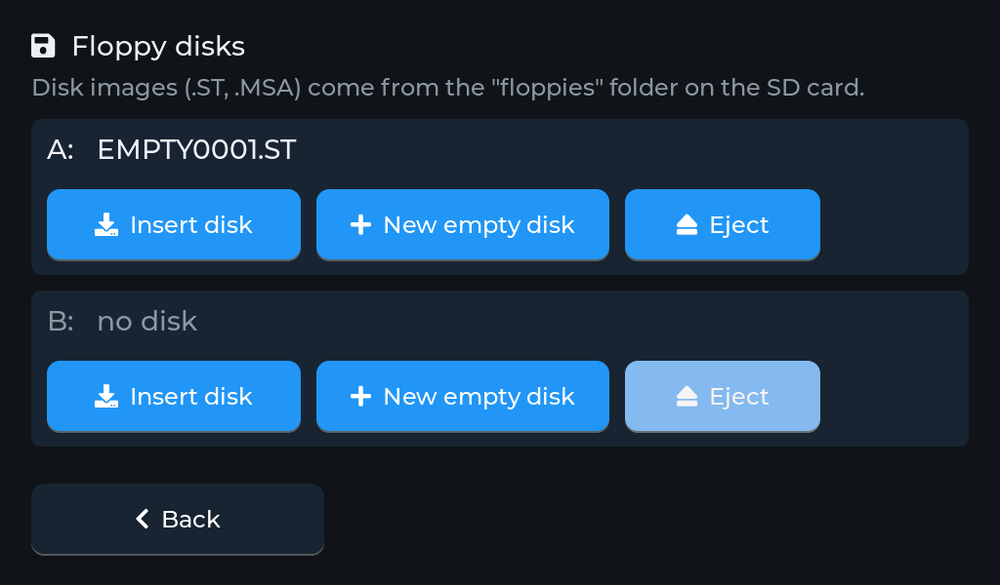
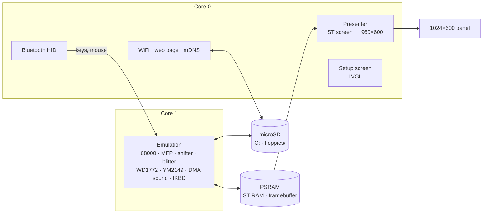

<h1 align="center">esp32ste</h1>

<p align="center">
  <b>An Atari STE on a 7-inch ESP32-S3 touch-screen board.</b><br>
  68000, TOS 1.62 / 2.06, up to 4 MB, floppies, hard disk, Bluetooth keyboard and mouse.
</p>

<p align="center">
  
  
  
  
  
</p>

<p align="center">
  
  
</p>

esp32ste turns the Makerfabs MaTouch ESP32-S3 Parallel TFT with Touch 7"
into an Atari STE. The ST picture fills the 1024×600 screen, a Bluetooth
keyboard and mouse stand in for the ST's own, the microSD card is hard disk
C:, and floppy disk images go in drives A: and B:. A setup screen on the
touch panel, and a web page on your network, handle everything else.

It's the sibling of [esp32mac](https://github.com/rlucencic/esp32mac)
(Macintosh Plus, SE, Classic), [esp32cpc](https://github.com/rlucencic/esp32cpc)
(Amstrad CPC), [esp32zx](https://github.com/rlucencic/esp32zx) (ZX
Spectrum) and [esp32cbm](https://github.com/rlucencic/esp32cbm) (Commodore
64 and 128), on the same board; all five are built on the shared runtime
[esp32emu](https://github.com/rlucencic/esp32emu).

## Features

**The machine**
- 68000 at 8 MHz ([Musashi](https://github.com/kstenerud/Musashi) core), about 80–85% of a real STE's speed
- TOS 1.62 or 2.06, chosen on the setup screen
- 512 KB, 1 MB or 4 MB of RAM
- Low, medium and high resolution on one screen, like a multisync monitor;
  Set Preferences offers all three, and the last one is remembered
- Blitter, YM2149 and STE DMA sound, MFP 68901, IKBD with the clock set from the internet

**Disks**
- **Hard disk C:** the SD card, at file level: copy programs onto the card
  from any computer, no disk image or driver needed
- **Floppy drives A: and B:** `.ST` images (read and written) and `.MSA`
  images (read-only), with a WD1772 controller that TOS can format disks on
- **New blank disks** from the setup screen: `EMPTY0001.ST`, `EMPTY0002.ST`, …
- A disk in A: at power-on boots, as games expect

**Around it**
- **Setup screen** before the ST starts, and any time while it runs (hold
  the top-right corner for 2 seconds): WiFi, Bluetooth pairing, TOS, RAM,
  floppy disks, reset
- **Bluetooth keyboard and mouse** (BLE HID), with battery levels
- **Web page** at `http://atari-ste.local`: drop `.ST`, `.MSA` or `.ZIP` files
  onto it to put them on the SD card, and watch the machine, drives, board
  and Bluetooth devices live
- **Sound** on the board's speaker (optional, `menuconfig`)

<p align="center">
  
  <br><sub>The web page (example data)</sub>
</p>

## Hardware

| | |
|---|---|
| Board | Makerfabs MaTouch ESP32-S3 Parallel TFT with Touch 7" |
| Module | ESP32-S3-WROOM-1-N16R8: 16 MB flash, 8 MB octal PSRAM |
| Screen | 1024×600 RGB, GT911 capacitive touch |
| Storage | microSD card (FAT32) |
| Input | any BLE keyboard and mouse |

## Getting started

### 1. What you need

- [ESP-IDF](https://github.com/espressif/esp-idf) v5.5 (developed with v5.5.4)
- TOS ROM images, which are copyrighted and **not included**: dumps of your
  own STE's TOS 1.62 and/or TOS 2.06 (256 KB each). Put them in `roms/` as
  `tos162.img` and `tos206.img`.
- A microSD card, FAT32
- [esp32emu](https://github.com/rlucencic/esp32emu), the shared board runtime, checked out next to
  this project (`../esp32emu`)

### 2. Build and flash

```sh
git clone https://github.com/rlucencic/esp32emu.git     # the shared runtime, next to it
git clone https://github.com/rlucencic/esp32ste.git && cd esp32ste
idf.py build
idf.py -p /dev/cu.usbmodem… flash      # app and both TOS images
```

Later updates only need `idf.py -p … app-flash`.

### 3. First start

1. The board starts on the **setup screen**. Tap **WiFi** to join your
   network: the clock is set from the internet, and the web page becomes
   reachable.
2. Tap **Bluetooth**, put your keyboard or mouse into pairing mode, and tap
   it in the list. Paired devices reconnect by themselves from then on.
3. Choose **TOS** and **memory**, then tap **Start Atari**.

## Using it

| To | Do |
|---|---|
| Get back to the setup screen | Hold the top-right corner of the screen for 2 s |
| Change TOS or RAM | On the setup screen; **Restart Atari** applies it |
| Insert a floppy | Setup screen → **Floppy** → **Insert disk**, or **Insert into…** on the web page |
| Make a blank floppy | Setup screen → **Floppy** → **New empty disk** |
| Copy disk images from a computer | Open `http://atari-ste.local` and drop them onto the page (ZIP files are unpacked) |
| …or from the command line | `curl -T game.st http://atari-ste.local/disks/` |
| Use programs from the SD card | Copy them anywhere on the card; they're on drive C: |

Disk images live in the `floppies` folder on the SD card. The inserted disks
are remembered across restarts.

<p align="center">
  
</p>

## Configuration

`idf.py menuconfig` → **Atari STE emulator**:

| Option | Default | |
|---|---|---|
| TOS, RAM | 1.62, 1 MB | Starting values; the setup screen's choice is remembered |
| Monochrome monitor | off | Start in high resolution |
| Offer all resolutions | on | Low, medium and high in Set Preferences |
| SD card as hard disk C: | on | Optionally only a folder of the card; boot from C: |
| Floppy folder | `floppies` | Where disk images are kept |

and → **Emulator board** (the shared runtime):

| Option | Default | |
|---|---|---|
| WiFi, setup screen | on | Time zone for the clock (POSIX TZ) |
| Start by itself | off | Countdown on the setup screen |
| Web page, network name | on, `atari-ste` | `http://<name>.local` |
| BLE keyboard and mouse | on | Mouse speed divider |
| Sound on the speaker | off | Volume; moves the console to the UART port |

## How it works



- **`components/atari_st`**: the STE, platform independent. It also builds
  on a desktop (`components/atari_st/host`) for testing with scripted mouse
  and keyboard input, screenshots and CPU traces.
- **`main`**: the STE on the board: memory, TOS, settings, keyboard map,
  floppy drives and status.
- **[esp32emu](https://github.com/rlucencic/esp32emu)** (shared with
  [esp32mac](https://github.com/rlucencic/esp32mac),
  [esp32cpc](https://github.com/rlucencic/esp32cpc),
  [esp32zx](https://github.com/rlucencic/esp32zx) and
  [esp32cbm](https://github.com/rlucencic/esp32cbm)): the board runtime (display, touch, SD card, WiFi,
  Bluetooth, setup screen, web page, serial console) and the 68000 core,
  Musashi from [evansm7's fork](https://github.com/evansm7/Musashi) with
  static opcode tables and the 68000 bus error frame.

TOS is patched in RAM, with every patch checked against the expected bytes:
all resolutions in Set Preferences, no wait for an ACSI hard disk when C: is
the SD card, and no ROM checksum test. Drive C: works at GEMDOS level through
a small cartridge program, so programs on the SD card run without a disk
image or hard disk driver.

## Development

```sh
make -C components/atari_st/host                     # desktop build of the STE
components/atari_st/host/build/st_host roms/tos206.img 600 out.ppm 1024

python ../esp32emu/tools/emu_console.py /dev/cu.usbmodem… lcd screen.png   # screenshot of the panel
python ../esp32emu/tools/emu_console.py /dev/cu.usbmodem… log 10           # board log
curl http://atari-ste.local/api/status                        # live status as JSON
```

`CLAUDE.md` has the details: architecture, memory budget, debugging options
and the lessons learned along the way.

## Limitations

- `.STX` (Pasti) images of copy-protected originals don't work; `.MSA`
  images are read-only.
- No FPU, ACSI, MIDI or Mega STE hardware.
- Floppy access is faster than a real drive, which a few loaders may notice.
- About 80–85% of real speed on the desktop; demanding demos will run slower.

## Credits

- [Musashi](https://github.com/kstenerud/Musashi) by Karl Stenerud (MIT
  licence), via Matt Evans' [fork](https://github.com/evansm7/Musashi) for
  embedded use
- [LVGL](https://lvgl.io) for the setup screen
- [ESP-IDF](https://github.com/espressif/esp-idf) and NimBLE
- The Atari ST community's documentation of the hardware, and
  [Hatari](https://www.hatari-emu.org) as the reference for how it behaves

## Licence

[MIT](LICENSE). The Musashi core in esp32emu is MIT licensed too (see
`../esp32emu/components/musashi/musashi/readme.txt`). LVGL (MIT) and ESP-IDF (Apache 2.0)
are fetched at build time and keep their own licences.

Atari, ST and TOS are trademarks of their respective owners. This project
contains no Atari code; you need your own TOS ROM images.
